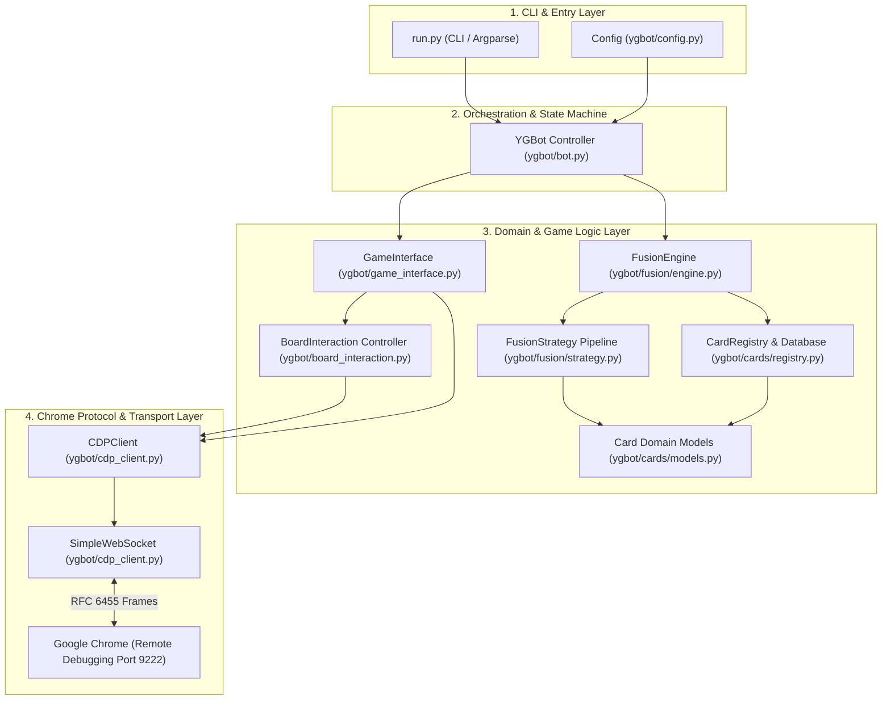
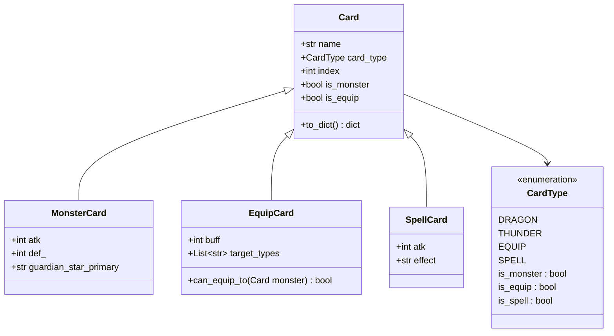
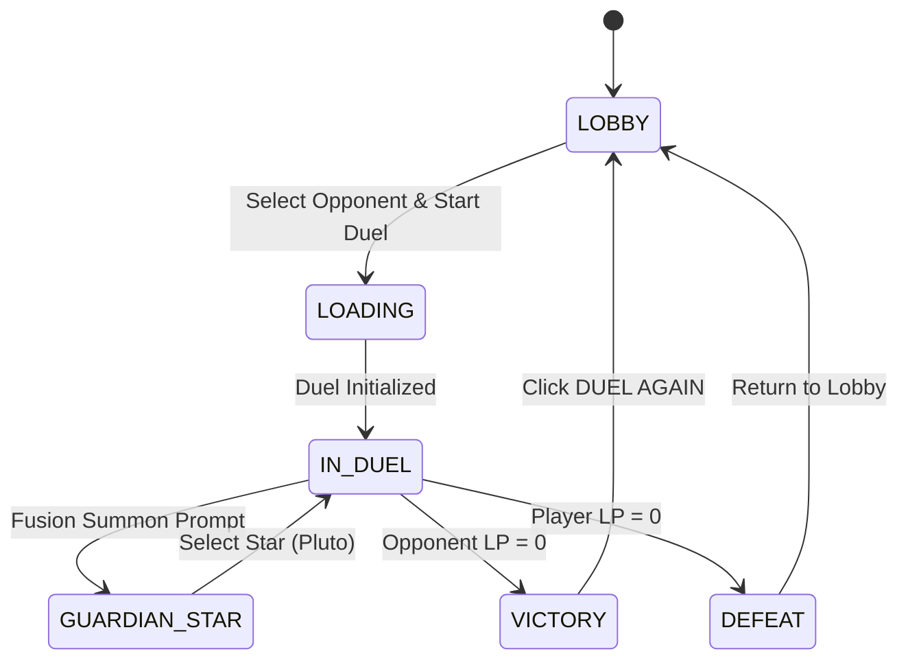
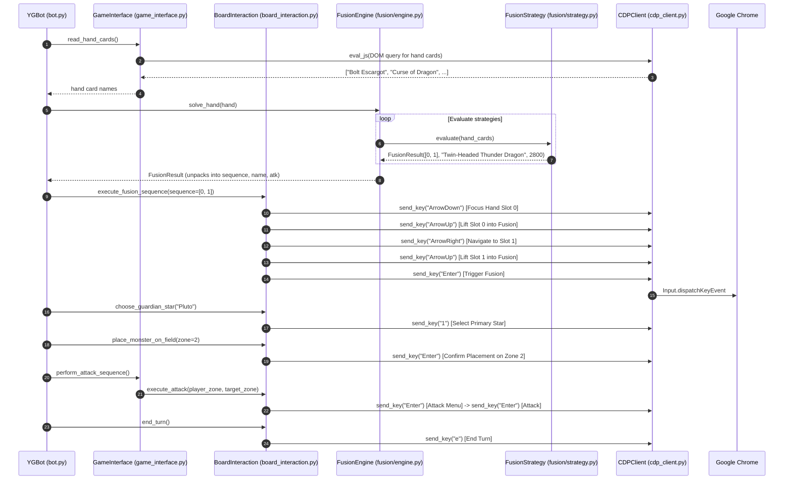

# YGBot - Code Architecture & Design Patterns Specification

This document provides a comprehensive technical breakdown of the architecture, component interactions, and software design patterns applied throughout the **YGBot (Yu-Gi-Oh! Forbidden Memories Online Auto-Dueler)** project.

---

## 1. High-Level Architectural Overview

YGBot is designed as an autonomous, zero-dependency browser automation bot for the web remake of *Yu-Gi-Oh! Forbidden Memories*. It interacts directly with Google Chrome via the Chrome DevTools Protocol (CDP) over a raw RFC 6455 WebSocket.

The system is split into four primary layers:



---

## 2. Design Patterns Applied

### Pattern 1: Strategy Pattern
* **Modules:** [`ygbot/fusion/strategy.py`](file:///home/paulo/Projects/YGBot/ygbot/fusion/strategy.py), [`ygbot/fusion/engine.py`](file:///home/paulo/Projects/YGBot/ygbot/fusion/engine.py)
* **Problem Solved:** Yu-Gi-Oh! Forbidden Memories has disparate fusion rules and playstyles. Combining all fusion logic in nested procedural `if/elif/else` statements violates the Open/Closed Principle (OCP), making it difficult to adjust priorities, add new fusions, or switch strategies (e.g. THTD speedrunning vs. highest ATK monster).
* **Participants:**
  * **Strategy Interface (`FusionStrategy`):** Defines the abstract method `evaluate(hand: List[Card]) -> Optional[FusionResult]`.
  * **Concrete Strategy 1 (`THTDFusionStrategy`):** Prioritizes the 2800+ ATK *Twin-Headed Thunder Dragon* combo (Thunder + Dragon), chaining additional dragons and compatible equip spells.
  * **Concrete Strategy 2 (`EquipBuffStrategy`):** Identifies optimal monster targets for equip spells (*Shine Palace*, *Dragon Treasure*) and chains duplicate monsters for fusion stat boosts.
  * **Concrete Strategy 3 (`ElementalFusionStrategy`):** Executes secondary classic fusions (*Dragon* + *Plant* $\rightarrow$ *Black Forest Dragon*, *Beast* + *Pyro* $\rightarrow$ *Flame Cerebrus*, *Rock* + *Female* $\rightarrow$ *Mystical Sand*).
  * **Concrete Strategy 4 (`HighestAtkStrategy`):** Standalone fallback that plays the highest base attack monster in hand when no fusion recipe exists.
  * **Context (`FusionEngine`):** Coordinates strategy resolution. It maintains an ordered list of strategies and evaluates the hand against them sequentially until an optimal play is found.
* **Open/Closed Principle:** New fusion strategies can be created by subclassing `FusionStrategy` and registered at runtime via `engine.register_strategy(new_strat, prepend=True)` without altering existing engine code.

---

### Pattern 2: Domain Model & Polymorphism
* **Modules:** [`ygbot/cards/card_type.py`](file:///home/paulo/Projects/YGBot/ygbot/cards/card_type.py), [`ygbot/cards/models.py`](file:///home/paulo/Projects/YGBot/ygbot/cards/models.py)
* **Problem Solved:** Originally, cards were represented as primitive untyped dictionaries (e.g. `{"type": "Dragon", "atk": 2000}`), which caused loose typing, string typo bugs, and brittle manual attribute checks.
* **Implementation:**
  * **`CardType` (Enumeration):** Represents all canonical archetypes (*Dragon*, *Thunder*, *Sea Serpent*, *Equip*, *Spell*, etc.) with domain query properties:
    * `card_type.is_monster`: Evaluates whether the card is a summonable creature.
    * `card_type.is_equip`: Evaluates whether the card is an equipment spell.
    * `card_type.is_spell`: Evaluates whether the card is a magic card.
  * **`Card` (Abstract Base Model):** Encapsulates identity (`name`), classification (`card_type: CardType`), and hand position (`index`).
  * **`MonsterCard(Card)`:** Specialized subclass containing combat metrics (`atk`, `def_`) and Guardian Stars.
  * **`EquipCard(Card)`:** Specialized subclass containing `buff: int` (+500) and target constraints with polymorphic business logic (`can_equip_to(monster: Card) -> bool`).
  * **`SpellCard(Card)`:** Specialized subclass for board wipes (*Raigeki*, *Dark Hole*).



---

### Pattern 3: Factory Method & Registry Pattern
* **Modules:** [`ygbot/cards/registry.py`](file:///home/paulo/Projects/YGBot/ygbot/cards/registry.py)
* **Problem Solved:** Hand inputs come from various sources (browser DOM attributes, heuristic OCR text, configuration files, or unit tests) in multiple formats (strings, dicts, model instances).
* **Implementation:**
  * **Registry:** `CardRegistry` maintains the canonical card database (`KNOWN_CARDS`), indexing stats and type affinities.
  * **Factory Method:** `create_card_from_name(name: str)` inspects known cards or runs heuristic token analysis (*"Dragon"*, *"Thunder"*, *"Whip"*) to instantiate the correct typed model (`MonsterCard`, `EquipCard`, or `SpellCard`).
  * **Universal Adapter:** `from_any(item)` converts any arbitrary input into a fully qualified `Card` object, insulating the fusion engine from data-format variability.

---

### Pattern 4: State Machine / State Pattern
* **Modules:** [`ygbot/bot.py`](file:///home/paulo/Projects/YGBot/ygbot/bot.py), [`ygbot/game_interface.py`](file:///home/paulo/Projects/YGBot/ygbot/game_interface.py)
* **Problem Solved:** Forbidden Memories Online progresses through distinct, non-linear phases (lobby selection, loading screen, duel battle, guardian star prompt, victory rewards).
* **Implementation:**
  * `GameState`: Enumerates system states (`LOBBY`, `LOADING`, `IN_DUEL`, `GUARDIAN_STAR`, `VICTORY`, `DEFEAT`).
  * `GameInterface.detect_screen_state()`: Evaluates page DOM text and canvas indicators to determine current state.
  * `YGBot.start_farming()`: Drives the state transitions:
    * In `LOBBY`: Invokes opponent selection and clicks START DUEL.
    * In `IN_DUEL`: Executes `run_duel_turn()` (hand reading $\rightarrow$ fusion $\rightarrow$ placement $\rightarrow$ attack).
    * In `VICTORY`: Clicks DUEL AGAIN and increments victory stats.



---

### Pattern 5: Controller & Command Pattern (Board Interaction & Keyboard Navigation)
* **Modules:** [`ygbot/board_interaction.py`](file:///home/paulo/Projects/YGBot/ygbot/board_interaction.py), [`ygbot/cdp_client.py`](file:///home/paulo/Projects/YGBot/ygbot/cdp_client.py)
* **Problem Solved:**
  Forbidden Memories Online runs as an emulator/canvas where mouse clicks alone are unreliable or desynced from the game's internal cursor state. The game requires native **keyboard navigation** (moving cursor across hand slots, lifting fusion cards, selecting field zones, and choosing modal options). Directly scattering keyboard keycodes throughout bot turn logic violates the Single Responsibility Principle and tightly couples game rules with hardware input protocol.
* **Implementation:**
  * **Controller Role (`BoardInteraction`):** Encapsulates the board's internal cursor state (`current_hand_slot`, `current_field_zone`) and provides high-level semantic methods (`focus_hand()`, `navigate_to_hand_slot()`, `lift_card_for_fusion()`, `execute_fusion_sequence()`, `place_monster_on_field()`, `choose_guardian_star()`, `execute_attack()`, `end_turn()`).
  * **Command Pattern:** Each discrete board interaction corresponds to a parameterized command:
    | High-Level Board Intent | Physical Key Command | Game Behavior in Forbidden Memories Online |
    | :--- | :--- | :--- |
    | `focus_hand()` | `ArrowDown` | Moves initial cursor focus to the 1st card in hand (slot 0) |
    | `navigate_to_hand_slot(i)` | `ArrowLeft` / `ArrowRight` | Navigates across the 5 hand slots (0 to 4) |
    | `lift_card_for_fusion()` | `ArrowUp` | Moves the focused card up into the fusion queue |
    | `trigger_fusion()` | `Enter` | Starts the fusion animation and calculation |
    | `place_monster_on_field(z)` | `ArrowLeft`/`ArrowRight` + `Enter` | Navigates across the 5 monster zones and confirms summon |
    | `choose_guardian_star(opt)` | `'1'` (Primary) / `'2'` (Secondary) | Selects the Guardian Star in the modal prompt (e.g. Pluto vs Mercury) |
    | `execute_attack(p_zone, o_zone)` | `Enter` $\rightarrow$ Attack $\rightarrow$ `Enter` | Opens card interaction menu, selects Attack, and confirms target |
    | `end_turn()` | `'e'` | Ends the player's turn immediately |
  * **Dual-Layer CDP Keyboard Dispatch:** `CDPClient.send_key()` issues native Chrome DevTools Protocol `Input.dispatchKeyEvent` events (`rawKeyDown`, `char`, `keyUp`) accompanied by simulated DOM `KeyboardEvent` dispatches on the active element/canvas.

---

### Pattern 6: Facade Pattern
* **Modules:** [`ygbot/fusion_engine.py`](file:///home/paulo/Projects/YGBot/ygbot/fusion_engine.py), [`ygbot/game_interface.py`](file:///home/paulo/Projects/YGBot/ygbot/game_interface.py)
* **Problem Solved:**
  * **Subsystem Complexity:** Interacting with Chrome DevTools Protocol requires raw JSON-RPC messaging, target discovery, coordinate transformations, and DOM evaluations.
  * **Backward Compatibility:** After refactoring `fusion_engine.py` into separate packages (`ygbot/cards/` and `ygbot/fusion/`), existing imports and documentation needed to function without breakages.
* **Implementation:**
  * `ygbot/fusion_engine.py` serves as a **Compatibility Facade**, re-exporting `FusionEngine`, `CardType`, `KNOWN_CARDS`, `MonsterCard`, and `FusionResult`.
  * `GameInterface` provides a simplified facade over `CDPClient`, offering simple high-level methods (`start_duel_from_lobby()`, `read_hand_cards()`, `perform_attack_sequence()`).

---

### Pattern 7: Adapter / Protocol Wrapper Pattern
* **Modules:** [`ygbot/cdp_client.py`](file:///home/paulo/Projects/YGBot/ygbot/cdp_client.py)
* **Problem Solved:** External third-party dependencies (like `selenium`, `playwright`, or `websockets`) introduce installation overhead and version drift. The bot must operate using Python standard libraries exclusively.
* **Implementation:**
  * `SimpleWebSocket`: Implements a pure standard-library client for the RFC 6455 WebSocket specification using `socket`, `struct`, `base64`, and `os.urandom`.
  * `CDPClient`: Adapts raw JSON-RPC 2.0 messages into structured browser actions (`Runtime.evaluate`, `Input.dispatchMouseEvent`, `/json/list` HTTP endpoint querying).

---

### Pattern 8: Value Object Pattern
* **Modules:** [`ygbot/fusion/result.py`](file:///home/paulo/Projects/YGBot/ygbot/fusion/result.py)
* **Problem Solved:** Results of a fusion evaluation comprise multiple values: card selection order (`sequence`), name of the resulting card (`play_name`), and computed attack power (`estimated_atk`).
* **Implementation:**
  * `FusionResult`: Immutable-like dataclass encapsulating the calculation outcome.
  * Implements `__iter__` to allow transparent 3-element tuple unpacking:
    ```python
    sequence, play_name, atk = fusion_engine.solve_hand(hand)
    ```
  * Retains both object-oriented access (`result.sequence`) and legacy tuple compatibility.

---

## 3. Sequence of a Single Duel Turn

The sequence diagram below shows how the refactored classes interact during an active duel turn:



---

## 4. Extensibility Guide

### Adding a New Fusion Strategy
To create and register a new custom strategy:

```python
from ygbot.fusion import FusionStrategy, FusionResult
from ygbot.cards import Card, CardType

class DragonZombieStrategy(FusionStrategy):
    """Fuses Dragon + Zombie into Zombie Dragon (2100 ATK)."""
    @property
    def name(self) -> str:
        return "DragonZombie"

    def evaluate(self, hand: list[Card]) -> FusionResult | None:
        dragons = [c for c in hand if c.card_type == CardType.DRAGON]
        zombies = [c for c in hand if c.card_type == CardType.ZOMBIE]
        if dragons and zombies:
            return FusionResult(
                sequence=[dragons[0].index, zombies[0].index],
                play_name="Zombie Dragon",
                estimated_atk=2100
            )
        return None

# Register with engine:
engine.register_strategy(DragonZombieStrategy(), prepend=True)
```

### Adding New Cards to the Registry
Cards can be registered dynamically or declared in `KNOWN_CARDS`:

```python
from ygbot.cards import CardRegistry, CardType

registry = CardRegistry.get_instance()
registry._db["Meteor B. Dragon"] = {
    "type": CardType.DRAGON.value,
    "atk": 3500,
    "def": 2000
}
```

---

## 5. Verification & Unit Testing

The architectural design is verified with comprehensive unit tests located at [`tests/test_fusion_and_cards.py`](file:///home/paulo/Projects/YGBot/tests/test_fusion_and_cards.py):

* **Model & Predicate Tests:** Ensures `CardType` domain predicates (`is_monster`, `is_equip`, `is_spell`) and equip affinity rules work accurately.
* **Registry & Heuristics Tests:** Verifies exact database lookups and fallback heuristic matching.
* **Strategy Tests:** Confirms correct sequence generation and ATK calculations for THTD, Equip buffing, Elemental fusions, and Highest ATK fallback.
* **Tuple Unpacking Tests:** Validates that `FusionResult` seamlessly unpacks into `(sequence, play_name, estimated_atk)`.

To run the test suite:
```bash
python3 -m unittest discover tests
```
