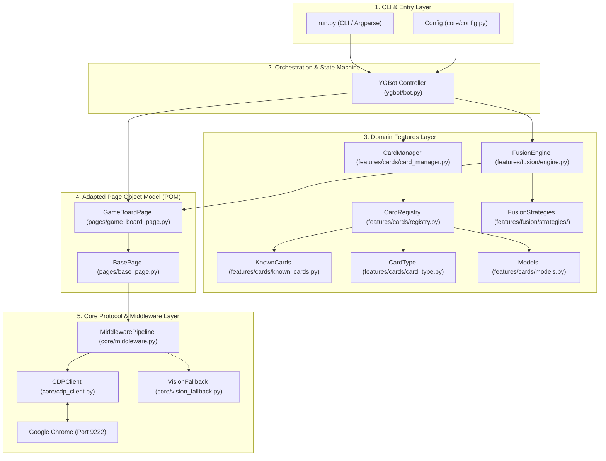
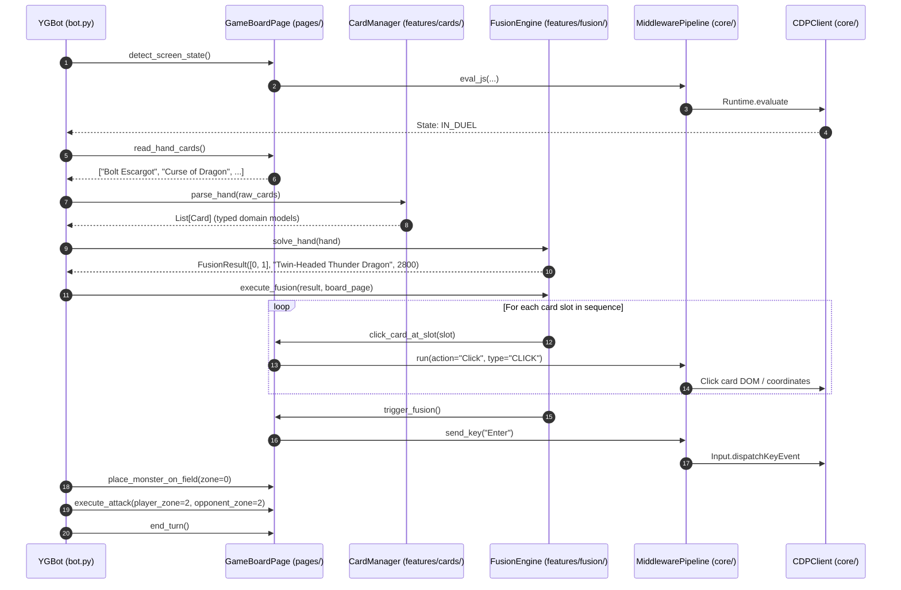
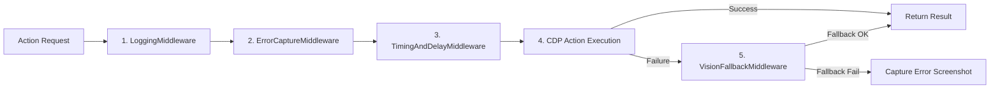

# YGBot - Code Architecture & Design Patterns Specification

This document provides a comprehensive technical breakdown of the architecture, component interactions, and software design patterns applied throughout the **YGBot (Yu-Gi-Oh! Forbidden Memories Online Auto-Dueler)** project.

---

## 1. High-Level Architectural Overview

YGBot is designed with clean Separation of Concerns, SOLID principles, and ACID operational guarantees. It is structured around the **Adapted Page Object Model (POM)** and an extensible **Middleware Execution Pipeline**.

### Target Architecture & Directory Tree

```
ygbot/
│
├── core/                       # Low-level browser, config & vision engine
│   ├── cdp_client.py           # Talks to Google Chrome (CDP WebSocket)
│   ├── vision_fallback.py      # Image recognition / template & coordinate matching
│   ├── middleware.py           # Execution pipeline & wrapper manager
│   ├── config.py               # Configuration manager (loads .env and config.json)
│   └── utils.py                # Logging, terminal colors, and formatting utilities
│
├── pages/                      # Adapted Page Object Model (POM)
│   ├── base_page.py            # Common browser actions wrapped with middleware
│   └── game_board_page.py      # Specific screen layouts (The game arena)
│
├── features/                   # Domain Logic (Cards & Fusions)
│   ├── cards/
│   │   ├── card_type.py        # CardType enum & archetypes
│   │   ├── known_cards.py      # Known cards database / catalog
│   │   ├── models.py           # Card data structures (name, ID, image hash)
│   │   ├── registry.py         # Factory Method & Card registry
│   │   └── card_manager.py     # Locates, parses, and evaluates cards on screen
│   └── fusion/
│       ├── result.py           # FusionResult Value Object
│       ├── engine.py           # Executes sequence of clicks for fusions
│       ├── strategy.py         # Strategy facade & coordinator
│       └── strategies/         # Isolated concrete strategy implementations
│           ├── base_strategy.py
│           ├── meteor_black_dragon.py
│           ├── thtd_strategy.py
│           ├── discard_cycle_strategy.py
│           ├── equip_buff_strategy.py
│           ├── elemental_fusion_strategy.py
│           └── highest_atk_strategy.py
│
├── bot.py                      # Main loop (Orchestrates the rolling console process)
└── run.py                      # Entry point
```

### Architectural Layer Interaction



---

## 2. Component Workflow: The Rolling Console Loop



### The Middleware Execution Pipeline
Every click, key dispatch, and evaluation flows through the standardized middleware pipeline:


Console Output Example:
```text
[Turn 14] Executing: Select Card at Slot 0...
[Turn 14] Select Card at Slot 0 -> Success (0.35s)
[Turn 14] Fusion triggered: Twin-Headed Thunder Dragon (Sequence: [1, 2]) -> Success
```

---

## 3. SOLID & ACID Software Principles Applied

### SOLID Principles

1. **Single Responsibility Principle (SRP):**
   - `CardRegistry` only handles model instantiation and token heuristics. `KNOWN_CARDS` and `CardType` were removed from `registry.py` and extracted into dedicated artifacts (`known_cards.py`, `card_type.py`).
   - Each fusion strategy resides in its own isolated file (`features/fusion/strategies/`), preventing long monolithic classes.
   - `GameBoardPage` encapsulates duel arena interaction without mixing strategy solving or low-level CDP packet framing.

2. **Open/Closed Principle (OCP):**
   - New fusion strategies can be added by creating a new file in `features/fusion/strategies/` subclassing `FusionStrategy` and registering it at runtime via `engine.register_strategy()`, without modifying existing engine logic.
   - New cross-cutting behaviors can be added as `Middleware` subclasses into `MiddlewarePipeline` without modifying `BasePage` or `GameBoardPage`.

3. **Liskov Substitution Principle (LSP):**
   - Any `FusionStrategy` implementation can seamlessly substitute for any other in `FusionEngine`.
   - Any `Card` subclass (`MonsterCard`, `EquipCard`, `SpellCard`) satisfies the `Card` base contract.

4. **Interface Segregation Principle (ISP):**
   - `BasePage` provides focused browser primitives.
   - `GameBoardPage` provides domain-specific page operations.
   - Callers only interact with the methods they need.

5. **Dependency Inversion Principle (DIP):**
   - `FusionEngine` depends on the `FusionStrategy` interface, not concrete strategy implementations.
   - `BasePage` interacts with browser protocols through the `MiddlewarePipeline` abstraction.

### ACID Principles in Bot Automation

- **Atomicity:** Multi-step sequences (such as a multi-card fusion chain or field placement) are handled with validation and fallback guards. If a modal unexpectedly intercepts the click, the state is recovered before continuing.
- **Consistency:** Hand slot tracking (`current_hand_slot`) and monster zone indices (`current_field_zone`) maintain invariant boundaries (0..4). The bot will not execute combat if the game screen is stuck in the Card Details modal.
- **Isolation:** Each turn iteration runs in an isolated `ActionContext` with independent timing metrics and error tracking, preventing corrupted state leakage between turns.
- **Durability:** Match outcomes, farming metrics, win rates, and diagnostic failure screenshots are persisted reliably.

---

## 4. Extensibility Guide

### Adding a New Fusion Strategy
Create a file `ygbot/features/fusion/strategies/my_new_strategy.py`:

```python
from typing import List, Optional
from ...cards.models import Card
from ..result import FusionResult
from .base_strategy import FusionStrategy

class MyNewStrategy(FusionStrategy):
    @property
    def name(self) -> str:
        return "MyNewStrategy"

    def evaluate(self, hand: List[Card]) -> Optional[FusionResult]:
        # Custom fusion evaluation logic
        return None
```

Register the strategy in `engine.py` or dynamically at runtime:
```python
engine.register_strategy(MyNewStrategy(), prepend=True)
```

---

## 5. Verification & Unit Testing

The test suite contains 52 comprehensive unit tests across 4 test modules:
* `tests/test_board_interaction.py`: 18 tests (board cursor tracking, keyboard navigation, modal handling).
* `tests/test_fusion_and_cards.py`: 18 tests (domain models, CardType predicates, registry lookup, heuristic parsing).
* `tests/test_pom_and_middleware.py`: 9 tests (Adapted Page Object Model, middleware pipeline, vision fallback, error capture).
* `tests/test_separated_strategies.py`: 7 tests (isolated strategy evaluation, FusionEngine delegation to GameBoardPage).

Run the full test suite:
```bash
python3 -m unittest discover tests
```
