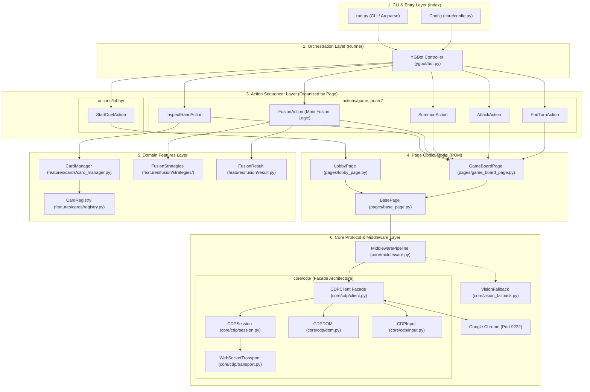
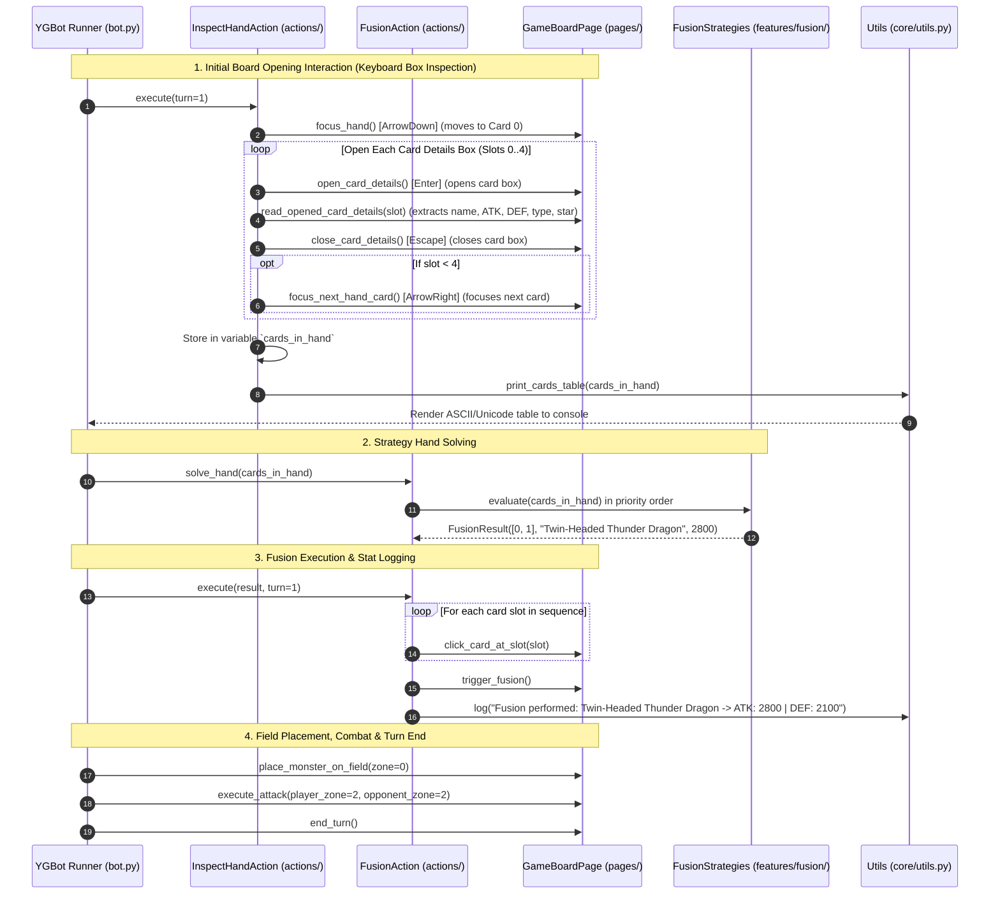

# YGBot - Code Architecture & Design Patterns Specification

This document provides a comprehensive technical breakdown of the architecture, component interactions, and software design patterns applied throughout the **YGBot (Yu-Gi-Oh! Forbidden Memories Online Auto-Dueler)** project.

---

## 1. High-Level Architectural Overview

YGBot is designed with clean Separation of Concerns, SOLID principles, and ACID operational guarantees. It is structured around the **Action Sequencer Pattern**, the **Adapted Page Object Model (POM)**, and an extensible **Middleware Execution Pipeline**.

### Target Architecture & Directory Tree

```
ygbot/
│
├── actions/                      # Discrete steps (Action Sequencer Pattern organized by page)
│   ├── base_action.py            # Abstract BaseAction defining contract for page interactions
│   ├── lobby/                    # Lobby Page interactions
│   │   └── start_duel_action.py  # Selects opponent and initiates duel from Free Duel lobby
│   └── game_board/               # Game Board Page interactions
│       ├── inspect_hand_action.py# Clicks cards one by one on initial open, stores in variable, prints table
│       ├── fusion_action.py      # Main fusion logic: solves hand via strategies, executes fusion, logs stats
│       ├── summon_action.py      # Selects Guardian Star & confirms field placement
│       ├── attack_action.py      # Executes combat attacks (player zone -> opponent zone)
│       └── end_turn_action.py    # Dispatches turn end ('e' key) with modal recovery
│
├── pages/                        # Page Object Model (Chrome DOM / Canvas wrappers)
│   ├── base_page.py              # Common browser primitives wrapped in middleware
│   ├── lobby_page.py             # Free duel lobby screen layout and matchmaking buttons
│   └── game_board_page.py        # Duel arena screen layout, hand cards, and field zones
│
├── core/                         # Low-level browser protocol, config, logger & vision fallback
│   ├── cdp/                      # Decoupled CDP Architecture (Facade Pattern)
│   │   ├── __init__.py
│   │   ├── transport.py          # Raw socket connections & RFC 6455 WebSocket framing
│   │   ├── session.py            # Tab querying, CDP WebSocket lifecycle, & JSON-RPC
│   │   ├── input.py              # Mouse clicks & keyboard dispatching
│   │   ├── dom.py                # Viewport sizing, JS evaluation, & DOM queries
│   │   └── client.py             # The Facade (exposes clean unified CDPClient / BrowserDriver API)
│   ├── cdp_client.py             # Backward-compatibility facade
│   ├── vision_fallback.py        # Coordinate / template matching fallback
│   ├── middleware.py             # Execution pipeline & wrapper manager (logging, errors, delay)
│   ├── config.py                 # Configuration manager (loads .env and config.json)
│   └── utils.py                  # Logger, ANSI colors, duration formatter, and ASCII card table
│
├── features/                     # Pure Domain Logic (Cards & Fusion Strategies)
│   ├── cards/
│   │   ├── card_type.py          # CardType enum & archetypes
│   │   ├── known_cards.py        # Known cards database / catalog (stats, archetypes, stars)
│   │   ├── models.py             # Card domain structures (MonsterCard, EquipCard, SpellCard)
│   │   ├── registry.py           # Factory Method & Card registry
│   │   └── card_manager.py       # Manages active card collections
│   └── fusion/                   # Domain Strategies & Supporting Classes ONLY (No engine class)
│       ├── result.py             # FusionResult Value Object
│       ├── strategy.py           # Base FusionStrategy contract and facade
│       └── strategies/           # Isolated concrete strategy implementations
│           ├── base_strategy.py
│           ├── meteor_black_dragon.py
│           ├── thtd_strategy.py
│           ├── discard_cycle_strategy.py
│           ├── equip_buff_strategy.py
│           ├── elemental_fusion_strategy.py
│           └── highest_atk_strategy.py
│
├── bot.py                        # Main orchestration loop (Runner) executing actions sequentially
└── run.py                        # CLI entry point (Index) parsing flags and starting the runner
```

### Architectural Layer Interaction



---

## 2. Component Workflow: The Rolling Console Loop



### Table Output upon Initial Board Open
Every time the duel board opens for the first time, `InspectHandAction` clicks cards one by one across hand slots 0 to 4, stores rich typed `Card` domain models in memory, and prints a formatted table to stdout:

```text
=== [ TURN 1 - HAND CARDS INSPECTED ] ===
┌──────┬────────────────────────────┬─────────────┬──────┬──────┬───────────────┐
│ Slot │ Card Name                  │ Type        │ ATK  │ DEF  │ Guardian Star │
├──────┼────────────────────────────┼─────────────┼──────┼──────┼───────────────┤
│ 1    │ Bolt Escargot              │ Thunder     │ 1400 │ 1500 │ Pluto         │
│ 2    │ Curse of Dragon            │ Dragon      │ 2000 │ 1500 │ Mars          │
│ 3    │ Dragon Treasure            │ Equip       │ +500 │ --   │ Dragon        │
│ 4    │ Baby Dragon                │ Dragon      │ 1200 │ 700  │ Sun           │
│ 5    │ Silver Fang                │ Beast       │ 1200 │ 800  │ Moon          │
└──────┴────────────────────────────┴─────────────┴──────┴──────┴───────────────┘
```

### Fusion Result Logging Output
After performing the fusion sequence on the board, `FusionAction` logs the resulting card's name, ATK, and DEF:

```text
02:00:57 [FUSION] [Turn 1] Executing fusion sequence: [1, 2] -> Twin-Headed Thunder Dragon
02:00:57 [SUCCESS] [Turn 1] Fusion performed: Twin-Headed Thunder Dragon -> ATK: 2800 | DEF: 2100
```

---

## 3. SOLID & ACID Software Principles Applied

### SOLID Principles

1. **Single Responsibility Principle (SRP):**
   - **Actions separated by page:** Discrete steps reside in page-dedicated action classes (`InspectHandAction`, `FusionAction`, `StartDuelAction`, etc.) rather than mixing automation logic into page DOM wrappers.
   - **Fusion logic extracted from domain:** The fusion orchestration engine was relocated from `features/fusion/` to `actions/game_board/fusion_action.py`. The `features/fusion/` directory now exclusively contains pure domain strategies and supporting value objects (`strategy.py`, `result.py`).
   - Each fusion strategy resides in its own isolated file (`features/fusion/strategies/`).

2. **Open/Closed Principle (OCP):**
   - New fusion strategies can be added by creating a new subclass of `FusionStrategy` in `features/fusion/strategies/` and registering it at runtime via `fusion_action.register_strategy()`, without modifying existing code.
   - New cross-cutting behaviors can be plugged into `MiddlewarePipeline` without modifying `BasePage` or `GameBoardPage`.

3. **Liskov Substitution Principle (LSP):**
   - Any `FusionStrategy` implementation can seamlessly substitute for any other in `FusionAction`.
   - Any `BaseAction` subclass can be executed by the runner through the unified `execute()` interface.

4. **Interface Segregation Principle (ISP):**
   - `BasePage` provides general browser primitives (`click`, `send_key`, `eval_js`).
   - `LobbyPage` handles lobby and matchmaking DOM interactions.
   - `GameBoardPage` handles arena-specific canvas and duel interactions.
   - Callers only invoke the methods specific to the active page context.

5. **Dependency Inversion Principle (DIP):**
   - `FusionAction` depends on the `FusionStrategy` abstraction, not concrete implementations.
   - High-level orchestration actions interact with browser protocols through the `BasePage` and `MiddlewarePipeline` abstractions.

### ACID Principles in Bot Automation

- **Atomicity:** Multi-step sequences (such as multi-card fusion chains or field placement) validate intermediate states. If a modal intercepts the click, state recovery handles it before proceeding.
- **Consistency:** Hand slot tracking and field zone indices maintain invariant boundaries (0..4). The bot will not execute combat if the game screen is stuck in the Card Details modal.
- **Isolation:** Each turn iteration runs in an isolated context with independent timing metrics and error tracking.
- **Durability:** Session statistics, win rates, and diagnostic failure screenshots are persisted reliably.

---

## 4. Verification & Unit Testing

The test suite contains 77 comprehensive unit tests across 6 test modules:
* `tests/test_cdp_architecture.py`: 15 tests (WebSocketTransport framing, CDPSession lifecycle, CDPDOM JS evaluation/viewport, CDPInput dispatching, CDPClient Facade delegation).
* `tests/test_page_actions.py`: 7 tests (Action Sequencer verification, InspectHandAction keyboard box opening [ArrowDown -> Enter -> Esc -> ArrowRight], FusionAction stat logging, LobbyPage actions).
* `tests/test_board_interaction.py`: 21 tests (board cursor tracking, card details box open/close, keyboard navigation, modal handling).
* `tests/test_fusion_and_cards.py`: 18 tests (domain models, CardType predicates, registry lookup, heuristic parsing).
* `tests/test_pom_and_middleware.py`: 9 tests (Adapted Page Object Model, middleware pipeline, vision fallback, error capture).
* `tests/test_separated_strategies.py`: 7 tests (isolated strategy evaluation, FusionAction Page Object delegation).

Run the full test suite:
```bash
python3 -m unittest discover tests
```
