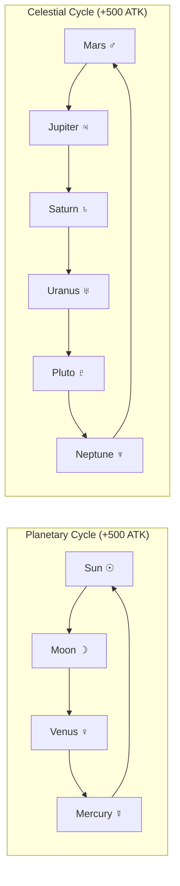

# Yu-Gi-Oh! Forbidden Memories - Game Mechanics & Knowledge Base

This guide documents the game mechanics, keyboard controls, card database, fusion recipes, and farming strategies for **Yu-Gi-Oh! Forbidden Memories Online** (`ygofm.com`) and the classic PS1 game.

---

## 1. What is Yu-Gi-Oh! Forbidden Memories?

Released for the Sony PlayStation in 1999 (Japan) and 2002 (North America/Europe), *Yu-Gi-Oh! Forbidden Memories* is an iconic standalone adaptation that diverged substantially from the official Yu-Gi-Oh! Official Card Game / Trading Card Game (TCG).

The modern web adaptation (**Forbidden Memories Online** at `https://ygofm.com/`) faithful reproduces the PS1 mechanics, animations, and card pool in a modern browser environment.

---

## 2. Core Duel Mechanics (Differences from Modern TCG)

| Mechanic | Forbidden Memories (PS1 / Web) | Modern TCG / Master Duel |
| :--- | :--- | :--- |
| **Summoning Limit** | **1 summon or fusion per turn** | 1 Normal Summon + Unlimited Special Summons |
| **Tributes / Sacrifices** | **Zero tributes required** (Level 7+ monsters like *Blue-Eyes* summon directly) | Level 5-6 requires 1 tribute; Level 7+ requires 2 |
| **Hand Replenishment** | **Hand draws back up to 5 cards** at the start of every turn | Draw only 1 card per turn during Draw Phase |
| **Polymerization** | **Not required!** Any cards can be overlaid to attempt a fusion | Specific spell and specific listed materials required |
| **Turn Phases** | Streamlined: **Summon/Fuse $\rightarrow$ Attack $\rightarrow$ End** (No Main Phase 2) | Draw $\rightarrow$ Standby $\rightarrow$ Main 1 $\rightarrow$ Battle $\rightarrow$ Main 2 $\rightarrow$ End |
| **Life Points** | **8,000 LP** | 8,000 LP |
| **Deck Size** | Exactly **40 cards** (Deck Out = instant defeat) | 40 to 60 cards |
| **Field Zones** | 5 Monster Zones + 5 Spell/Trap Zones | 5 Monster Zones + 5 Spell/Trap Zones + Extra Zones |

---

## 3. Keyboard Navigation & Controls Guide

The web version of Forbidden Memories Online accepts direct keyboard controls. These keys are used by `BoardInteraction` ([ygbot/board_interaction.py](file:///home/paulo/Projects/YGBot/ygbot/board_interaction.py)):

```text
               [ ArrowUp ] (Lift card into Fusion)
                     ▲
                     │
[ ArrowLeft ] ◄──  Cursor  ──► [ ArrowRight ] (Navigate Hand / Field)
                     │
                     ▼
              [ ArrowDown ] (Focus Hand / Move to Fusion Button)

[ Enter ]    : Confirm action / Start fusion / Summon / Select attack target
[ 1 ]        : Choose Primary Guardian Star (e.g. Pluto, Sun, Mars)
[ 2 ]        : Choose Secondary Guardian Star (e.g. Mercury, Moon, Jupiter)
[ e ] / [ E ]: End turn immediately
```

### Turn Interaction Walkthrough:
1. **Focus Hand:** Press `ArrowDown` at the start of your turn to focus the first card (Slot 0).
2. **Select Materials & Card Details:** Navigate between cards 0 to 4 using `ArrowLeft` and `ArrowRight`. Clicking or focusing a card opens its **Card Details** modal window (displaying ATK, DEF, Guardian Stars, and action buttons).
3. **Queue Fusion via Card Details:** On the Card Details window, press `ArrowDown` to navigate focus down to the **FUSION** action button (`data-testid="summon-chain"`), then press `Enter` (or click `[ ⚡ FUSION ]`). This queues the card as a fusion component and returns to the hand.
4. **Trigger Fusion:** After queuing all required fusion components (e.g., Red-Eyes Black Dragon + Meteor Dragon), click the green checkmark `[ ✔ ]` or press `Enter` to initiate the fusion sequence.
5. **Guardian Star Modal:** When prompted to pick a Guardian Star:
   * Press `1` for the left/primary star (e.g. Pluto for THTD).
   * Press `2` for the right/secondary star (e.g. Sun for Meteor Black Dragon).
6. **Field Placement:** Use `ArrowLeft` / `ArrowRight` to select a monster zone (0 to 4), then press `Enter` to confirm placement.
7. **Combat / Attacking:**
   * Focus your monster on the field.
   * Press `Enter` to open the interaction menu.
   * Press `Enter` to confirm "Attack".
   * Navigate with `ArrowLeft` / `ArrowRight` to target an opponent's monster or direct LP.
   * Press `Enter` to strike!
8. **End Turn:** Press `e` to pass the turn to the opponent.
9. **Surrender Safety:** If an accidental concession dialog ("CONCEDE THIS MATCH NOW?") is detected, the bot immediately triggers `Cancel` to prevent forfeiting matches.

---

## 4. The Guardian Star System

Every monster card has two selectable **Guardian Stars** (Zodiac / Astrological signs). During battle, if your monster's star has an advantage over the opponent's star, your monster receives a **+500 ATK and +500 DEF boost** for that battle calculation!

The stars are divided into two independent circular relationships:



### Why YGBot Defaults to Pluto:
* **Pluto beats Neptune** (+500 ATK), which neutralizes opposing Aqua and Sea Serpent monsters.
* Few early-game campaign opponents prioritize Uranus, keeping your *Twin-Headed Thunder Dragon* safe from defensive disadvantages.

---

## 5. Canonical Fusion Recipes & Priority Strategy

YGBot evaluates hands using a strict, optimal farming hierarchy:

1. **Top Priority: Meteor Black Dragon Fusion + Equip (3500 - 4000+ ATK)**
   - **Materials:** *Red-Eyes B. Dragon* (2400 ATK) + *Meteor Dragon* (1800 ATK).
   - **Equip Addition:** Immediately appends compatible equip cards (*Dragon Treasure*) to reach **4000+ ATK** in the same turn!
   - **Guardian Star:** *Sun* (countering Moon / Dark Magician / spellcasters).
2. **Second Priority: Twin-Headed Thunder Dragon Fusion + Equip (2800 - 3300+ ATK)**
   - **Materials:** Any *Thunder* monster + any *Dragon* monster.
   - **Equip Addition:** Appends compatible equip cards (*Dragon Treasure*, *Shine Palace*, *Electro-Whip*).
   - **Guardian Star:** *Pluto* (countering Neptune / Aqua).
3. **Third Priority: Discard & Hand Cycling (When no THTD or Meteor Black Dragon exists)**
   - **Repeated Dragons:** Discards duplicate dragons, keeping only the single strongest dragon.
   - **Repeated Thunders:** Discards duplicate thunders, keeping only the single strongest thunder.
   - **Extra Equips:** If holding more than 2 equip cards, discards the extra ones.
   - **Mechanism:** Fuses/burns the dead cards into the Graveyard, placing the keeper monster on field, ensuring the hand automatically draws fresh replacements next turn!

### Standard Forbidden Memories Fusion Table:

| Result Monster | ATK | DEF | Recipe Requirements | Notes |
| :--- | :--- | :--- | :--- | :--- |
| **Meteor Black Dragon** | **3500** | **2000** | **Meteor Dragon + Red-Eyes B. Dragon** | Highest ATK fusion in the game; 4000 ATK with Dragon Treasure. |
| **Twin-Headed Thunder Dragon** | **2800** | **2100** | **Dragon + Thunder** | The cornerstone speedrun and farming monster. |
| **Black Forest Dragon** | **2100** | **1800** | **Dragon + Plant** | Secondary high-ATK early-game dragon fusion. |
| **Flame Cerebrus** | **2100** | **1800** | **Beast + Pyro** | Powerful non-dragon fusion. |
| **Mystical Sand** | **2100** | **1700** | **Rock + Female** | Highly consistent secondary fusion. |
| **Stone Dragon** | **2000** | **2300** | **Dragon + Rock** | High-defense wall. |
| **Metal Dragon** | **1850** | **1700** | **Dragon + Machine** | Solid mid-tier fusion. |
| **Koumori Dragon** | **1500** | **1200** | **Dragon + Fiend** | Stepping stone to higher dragon fusions. |

---

## 6. Known Cards Database in YGBot

The bot's built-in registry ([ygbot/cards/registry.py](file:///home/paulo/Projects/YGBot/ygbot/cards/registry.py)) tracks key cards:

### Thunder Monsters (THTD Material 1)
| Card Name | ATK | DEF | Archetype |
| :--- | :--- | :--- | :--- |
| **Kaminari Attack** | 1900 | 1400 | Thunder |
| **Thunder Dragon** | 1600 | 1500 | Thunder |
| **The Immortal of Thunder** | 1500 | 1300 | Thunder |
| **Bolt Escargot** | 1400 | 1500 | Thunder |
| **Oscillo Hero #2** | 1000 | 500 | Thunder |
| **Electric Lizard** | 850 | 800 | Thunder |
| **Mega Thunderball** | 750 | 600 | Thunder |
| **Lala Li-Oon** | 600 | 600 | Thunder |

### Dragon Monsters (THTD Material 2)
| Card Name | ATK | DEF | Archetype |
| :--- | :--- | :--- | :--- |
| **Blue-Eyes White Dragon** | 3000 | 2500 | Dragon |
| **Red-Eyes B. Dragon** | 2400 | 2000 | Dragon |
| **B. Dragon Jungle King** | 2100 | 1800 | Dragon |
| **Curse of Dragon** | 2000 | 1500 | Dragon |
| **Meteor Dragon** | 1800 | 2000 | Dragon |
| **Blackland Fire Dragon** | 1500 | 800 | Dragon |
| **Koumori Dragon** | 1500 | 1200 | Dragon |
| **Baby Dragon** | 1200 | 700 | Dragon |
| **Yamatano Dragon Scroll** | 900 | 300 | Dragon |
| **One-Eyed Shield Dragon** | 700 | 1300 | Dragon |
| **Petit Dragon** | 600 | 700 | Dragon |

### Equip Magic Cards (+500 ATK/DEF)
| Card Name | Buff | Compatible Target Archetypes |
| :--- | :--- | :--- |
| **Dragon Treasure** | +500 | Dragon |
| **Shine Palace** | +500 | Light, Sea Serpent, Thunder |
| **Dark Energy** | +500 | Fiend, Spellcaster |
| **Beast Fangs** | +500 | Beast |
| **Invigoration** | +500 | Rock, Pyro |
| **Electro-Whip** | +500 | Female, Thunder |

### Powerful Spell & Board Clear Cards
* **Raigeki**: Destroys all opponent monsters on field.
* **Dark Hole**: Destroys all monsters on the field.
* **Harpie's Feather Duster**: Destroys all opponent spells and traps.
* **Swords of Revealing Light**: Prevents opponent attacks for 3 turns.

---

## 7. Campaign Opponents & Farming Guide

In Free Duel mode, dueling specific opponents yields vital cards to build an unbeatable deck:

* **High Mage Martis:** Primary default target. Rewards high-tier dragons, equips, and magic cards.
* **Meadow Mage:** Renowned for dropping *Meteor B. Dragon* (3500 ATK), *Skull Knight* (2650 ATK), and *Gaia the Fierce Knight* (2300 ATK) upon S/A-Rank POW victory.
* **Jono 2nd:** Primary source for *Red-Eyes B. Dragon*.
* **Pegasus:** Source for *Megamorph*, *Bright Castle*, and *Dragon Treasure*.
