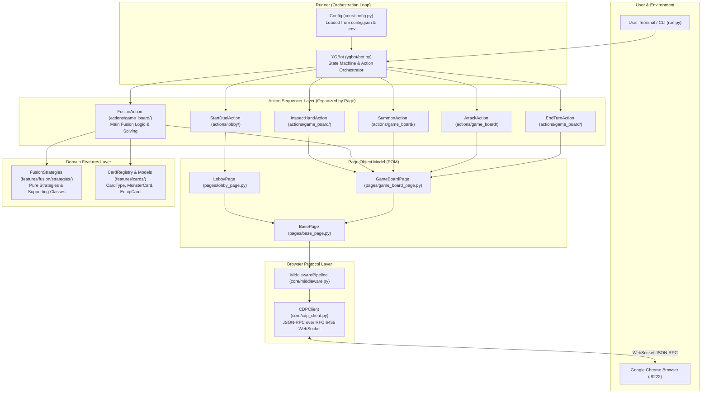
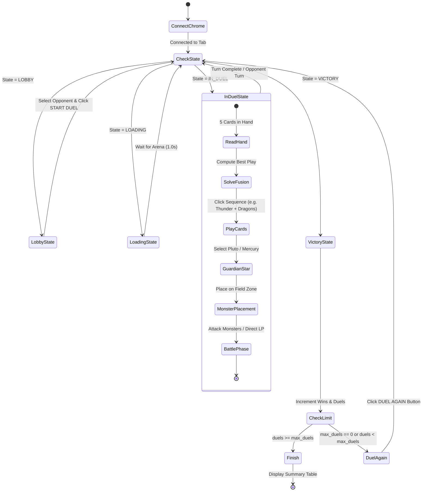

# YGBot - Yu-Gi-Oh! Forbidden Memories Online Auto-Dueler

An autonomous, zero-dependency Python bot that plays **Yu-Gi-Oh! Forbidden Memories Online** directly in Google Chrome.

> 📚 **Architecture & Design Patterns:** See [**CODE_ARCHITECTURE.md**](CODE_ARCHITECTURE.md) for the detailed explanation of the project's code design, class diagrams, sequence flows, and all software design patterns applied.
>
> 🎮 **Game Rules, Mechanics & Card Database:** See [**GAME.md**](GAME.md) for the complete guide to Forbidden Memories mechanics, Guardian Star wheel, fusion recipes, keyboard controls, and card lists.

---

# Section 1: How to Use the Bot

## 1. Prerequisites
- **Python 3.8+** (installed and available in your PATH)
- **Google Chrome** (or Chromium)
- **No external Python libraries required!** The bot is built using Python's standard library and communicates directly with Chrome via the Chrome DevTools Protocol (CDP).

---

## 2. Step-by-Step Usage Guide

### Step 1: Launch Google Chrome with Remote Debugging
The bot connects to Google Chrome using its built-in remote debugging port (`9222`).

You can launch Chrome using the included helper script:
```bash
./launch_chrome.sh
```

Or run Chrome directly from your terminal with a separate profile (so it doesn't conflict if Chrome is already open):
```bash
google-chrome --remote-debugging-port=9222 --user-data-dir="$HOME/.config/ygbot-chrome" "https://ygofm.com/"
```

> **Note:** If Chrome is already running on your computer, Chrome will refuse to open remote debugging without `--user-data-dir` (or until you close all existing Chrome windows). Using `./launch_chrome.sh` handles this automatically.
> Log into your game account in this browser window and navigate to the **Free Duel** screen.

---

### Step 2: Start the Auto-Dueler
In the project directory, run:
```bash
python3 run.py
```

The bot will automatically:
1. Detect your running Chrome window and locate the Forbidden Memories tab.
2. Select your chosen opponent (default: **High Mage Martis**) and click **START DUEL**.
3. Read your hand cards each turn and calculate the highest ATK fusion (e.g., **Twin-Headed Thunder Dragon** at 2800+ ATK).
4. Click the cards in sequence, select the **Guardian Star** (*Pluto*), and place the monster.
5. Enter combat and attack opponent monsters / direct LP.
6. Detect the **VICTORY** screen and click **DUEL AGAIN** to repeat the farming cycle indefinitely.

---

### Step 3: Stopping the Bot & Viewing Stats
Press `Ctrl+C` in your terminal at any time to pause or stop the bot. It will gracefully disconnect and display your session summary:

```text
================================================================
                  FARMING SESSION SUMMARY
================================================================
 Opponent Farmed:     High Mage Martis
 Total Duels:         25
 Victories:           25
 Win Rate:            100.0%
 Total Session Time:  14m 32s
 Avg Time per Duel:   34s
================================================================
```

---

## 3. Command-Line Options

You can override settings on the fly using CLI flags:

| Flag | Short | Description | Default |
| :--- | :--- | :--- | :--- |
| `--url` | `-u` | Target game URL to play | `"https://ygofm.com/"` |
| `--opponent` | `-o` | Name of opponent to farm in Free Duel | `"High Mage Martis"` |
| `--duels` | `-d` | Number of duels to farm (`0` = infinite loop) | `0` (Infinite) |
| `--port` | `-p` | Chrome remote debugging port | `9222` |
| `--star` | `-s` | Preferred Guardian Star | `"Pluto"` |
| `--strategy` | | Fusion strategy: `THTD` or `highest_atk` | `"THTD"` |
| `--test` | | Run diagnostic test to check Chrome connection | `False` |
| `--launch-chrome` | | Automatically spawn Chrome before dueling | `False` |

### CLI Examples

- **Test Chrome connection:**
  ```bash
  python3 run.py --test
  ```

- **Farm 50 duels against High Mage Martis:**
  ```bash
  python3 run.py --duels 50 --opponent "High Mage Martis"
  ```

- **Farm Meadow Mage indefinitely:**
  ```bash
  python3 run.py --opponent "Meadow Mage"
  ```

- **Launch Chrome and start dueling in one command:**
  ```bash
  python3 run.py --launch-chrome --opponent "High Mage Martis"
  ```

---

## 4. Configuration Options (`.env` and `config.json`)

Settings can be customized either via an environment file [`.env`](file:///home/paulo/Projects/YGBot/.env) or JSON config [config.json](file:///home/paulo/Projects/YGBot/config.json).

### Environment File (`.env`)
You can configure the target website and runtime parameters in `.env`:
```env
# Target Game Website
GAME_URL=https://ygofm.com/
TARGET_URL_PATTERN=ygofm.com
ALT_URL_PATTERN=intercityygo.com

# Chrome Remote Debugging Settings
CHROME_HOST=127.0.0.1
CHROME_PORT=9222
CHROME_BINARY=google-chrome
AUTO_LAUNCH=false

# Duel & Farming Settings
OPPONENT=High Mage Martis
MAX_DUELS=0
STRATEGY=THTD
GUARDIAN_STAR=Pluto
ACTION_DELAY=0.5
TURN_WAIT=1.5
COMBAT_WAIT=2.0
LOADING_TIMEOUT=30.0
```

### JSON File (`config.json`)
Persistent options can also be edited directly in [config.json](file:///home/paulo/Projects/YGBot/config.json):

```json
{
  "chrome": {
    "host": "127.0.0.1",
    "debug_port": 9222,
    "game_url": "https://ygofm.com/",
    "target_url_pattern": "ygofm.com"
  },
  "farming": {
    "opponent": "High Mage Martis",
    "max_duels": 0,
    "strategy": "THTD",
    "guardian_star": "Pluto",
    "action_delay": 0.5,
    "turn_wait": 1.5,
    "combat_wait": 2.0
  }
}
```

---

# Section 2: Code Structure & Architecture

> 📖 **Detailed Architecture & Design Patterns:**
> For an in-depth breakdown of the object-oriented design, class interaction diagrams, sequence flows, and all software design patterns applied across the project (Strategy, Domain Model, Factory/Registry, State Machine, Facade, Adapter, and Value Object), see **[CODE_ARCHITECTURE.md](CODE_ARCHITECTURE.md)**.

## 1. Directory Layout

```text
/home/paulo/Projects/YGBot/
├── README.md                  # Quickstart documentation, usage guide & overview
├── CODE_ARCHITECTURE.md       # Comprehensive explanation of code design & design patterns
├── GAME.md                    # Complete game mechanics, Guardian Star wheel & card database
├── .env                       # Environment configuration (target URL, ports, opponent)
├── .env.example               # Template for environment configuration
├── config.json                # User settings (opponent, strategy, speed, coordinates)
├── run.py                     # CLI entry point (Index)
├── launch_chrome.sh           # Helper script to start Chrome with debugging
├── requirements.txt           # Optional dependencies (core bot needs 0 external packages)
├── tests/
│   ├── test_page_actions.py   # Unit test suite for Page Actions, hand table printing & fusion logging
│   ├── test_fusion_and_cards.py    # Unit test suite for cards, registry, and fusion strategies
│   ├── test_board_interaction.py   # Unit test suite for keyboard navigation and board controller
│   ├── test_pom_and_middleware.py  # Unit test suite for POM and middleware pipeline
│   └── test_separated_strategies.py # Unit test suite for isolated fusion strategies
└── ygbot/
    ├── __init__.py            # Package declaration & exports
    ├── bot.py                 # Main Orchestration Loop (Runner)
    ├── actions/               # Discrete steps (Action Sequencer Pattern organized by page)
    │   ├── base_action.py     # Base contract for page actions
    │   ├── lobby/             # Actions executed on LobbyPage
    │   │   └── start_duel_action.py   # Selects opponent & clicks START DUEL
    │   └── game_board/        # Actions executed on GameBoardPage
    │       ├── inspect_hand_action.py # Clicks cards one by one on initial open, stores in variable, prints table
    │       ├── fusion_action.py       # Main fusion logic: solves hand via strategies, executes fusion, logs stats
    │       ├── summon_action.py       # Guardian Star selection & monster field placement
    │       ├── attack_action.py       # Initiates combat attacks
    │       └── end_turn_action.py     # Ends turn safely ('e' key)
    ├── pages/                 # Page Object Model (Chrome DOM / Canvas wrappers)
    │   ├── base_page.py       # Low-level browser primitives wrapped with middleware
    │   ├── lobby_page.py      # Lobby screen and matchmaking DOM interactions
    │   └── game_board_page.py # Duel arena layout, hand slots, and field zones
    ├── core/                  # Low-level browser protocol, config, logger & vision fallback
    │   ├── cdp/               # Decoupled CDP Subsystems (Facade Pattern)
    │   │   ├── transport.py   # Raw TCP socket & RFC 6455 WebSocket framing
    │   │   ├── session.py     # Tab querying, WebSocket lifecycle, & JSON-RPC
    │   │   ├── input.py       # Mouse clicks & physical/synthetic keyboard dispatching
    │   │   ├── dom.py         # Viewport sizing, JS evaluation, & DOM queries
    │   │   └── client.py      # The Facade (CDPClient / BrowserDriver)
    │   ├── cdp_client.py      # Backward-compatibility facade
    │   ├── vision_fallback.py # Coordinate & vision matching fallback
    │   ├── middleware.py      # Execution pipeline (logging, error capture, delays, fallback)
    │   ├── config.py          # Configuration loader (.env and config.json)
    │   └── utils.py           # Logger, ANSI colors, duration formatter, and ASCII card table
    └── features/              # Pure Domain Logic (Cards & Fusion Strategies)
        ├── cards/             # Domain models, known cards catalog & CardRegistry
        └── fusion/            # Fusion strategies & supporting classes ONLY (No engine class)
            ├── strategy.py    # FusionStrategy interface & coordinator
            ├── result.py      # FusionResult Value Object
            └── strategies/    # Isolated concrete strategy implementations (THTD, Meteor Black Dragon, etc.)
```

---

## 2. Module Responsibilities

### `run.py` (CLI Index)
The CLI entry point. Parses command-line arguments, prints the terminal banner, handles the `--test` diagnostic flag, optionally spawns Chrome, and starts the runner (`YGBot`).

### `ygbot/bot.py` (`YGBot` Runner)
The central orchestration loop executing actions sequentially:
- Connects to Google Chrome via CDP.
- Dispatches page-organized actions (`StartDuelAction` on `LobbyPage`, `InspectHandAction`, `FusionAction`, `SummonAction`, `AttackAction`, and `EndTurnAction` on `GameBoardPage`).
- Tracks duel statistics (victories, duels played, win rate, duration per duel).
- Handles graceful interrupts (`Ctrl+C`) and prints the final session summary.

### `ygbot/actions/` (Action Sequencer Pattern)
Discrete gameplay actions organized by the page where the interaction occurs:
- **`InspectHandAction`** (`actions/game_board/`): Every time the duel board opens for the first time, navigates cards using the keyboard (`ArrowDown` to focus 1st card, then loops: `Enter` to open card box, reads optimal details, `Esc` to close box, `ArrowRight` to focus next card), stores verified cards into variable `cards_in_hand`, and prints an ASCII/Unicode table of hand cards to the console.
- **`FusionAction`** (`actions/game_board/`): Encapsulates the main fusion logic. Evaluates hand cards against the prioritized strategy chain (`solve_hand`), executes the sequence of card clicks on `GameBoardPage`, triggers fusion, and logs the resulting card's name, ATK, and DEF to the console.
- **`SummonAction`** (`actions/game_board/`): Manages Guardian Star selection and confirms placement of monsters on player field zones.
- **`AttackAction`** (`actions/game_board/`): Dispatches combat commands from designated field monster zones to opponent zones or direct LP.
- **`EndTurnAction`** (`actions/game_board/`): Dispatches turn end ('e' key) with accidental surrender prompt protection.
- **`StartDuelAction`** (`actions/lobby/`): Interacts with `LobbyPage` to search for and select opponents and click **START DUEL**.

### `ygbot/pages/` (Adapted Page Object Model)
Encapsulates Chrome DOM and canvas interaction without mixing domain or action logic:
- **`BasePage`**: Unified browser interactions wrapped inside the middleware execution pipeline.
- **`LobbyPage`**: Opponent card selection and START DUEL / DUEL AGAIN buttons.
- **`GameBoardPage`**: Hand slots (0..4), field zones (0..4), Card Details modal, and Guardian Star prompts.

### `ygbot/features/fusion/` (Pure Domain Strategies)
Contains ONLY fusion strategies and supporting classes:
- **`FusionStrategy`** (`strategy.py`): Abstract base strategy defining the evaluation interface.
- **`strategies/`**: Concrete strategy implementations (`MeteorBlackDragonStrategy`, `THTDFusionStrategy`, `DiscardAndCycleStrategy`, `EquipBuffStrategy`, `ElementalFusionStrategy`, `HighestAtkStrategy`).
- **`FusionResult`** (`result.py`): Immutable Value Object holding fusion sequence, play name, estimated ATK, and recommended Guardian Star.

### `ygbot/features/cards/` (Domain Models & Catalog)
- **`CardType`** (`card_type.py`): Enumeration representing all classic Forbidden Memories archetypes.
- **`models.py`**: Strongly typed domain classes (`MonsterCard`, `EquipCard`, `SpellCard`).
- **`known_cards.py`**: Catalog database of known cards, stats (ATK/DEF), archetypes, and Guardian Stars.
- **`registry.py`**: Factory Method normalizing inputs into typed `Card` models.

### `ygbot/core/cdp/` (Decoupled CDP Architecture - Facade Pattern)
- **`CDPClient` / `BrowserDriver`** (`client.py`): The main Facade coordinating specialized subsystems. Strips out raw socket work and exposes a clean, unified browser automation interface.
- **`WebSocketTransport` / `SimpleWebSocket`** (`transport.py`): Low-level TCP socket lifecycle, RFC 6455 handshakes, frame encoding, masking, and ping/pong handling.
- **`CDPSession`** (`session.py`): Tab querying (`/json/list`, `/json/version`), WebSocket lifecycle, and JSON-RPC command correlation.
- **`CDPDOM`** (`dom.py`): Layout viewport sizing, JavaScript expression evaluation, and DOM element bounds querying.
- **`CDPInput`** (`input.py`): Mouse clicks, coordinate scaling, and physical/synthetic keyboard dispatching (`ArrowDown`, `Enter`, `Escape`, `ArrowRight`, etc.).

### `ygbot/core/` (Core Protocol & Utilities)
- **`cdp_client.py`**: Backward-compatibility facade module re-exporting `ygbot.core.cdp`.
- **`middleware.py`**: Execution pipeline (Logging, ErrorCapture, Delay, VisionFallback).
- **`config.py`**: Configuration manager (.env and config.json loader).
- **`utils.py`**: Terminal formatting, rolling console logger, duration helper, and hand card table renderer (`format_cards_table`, `print_cards_table`).

---

## 3. Architecture Diagram

The diagram below illustrates how each component communicates:



---

## 4. Autonomous State Machine Flowchart

The following diagram shows the decision cycle executed by `YGBot` on every iteration:


