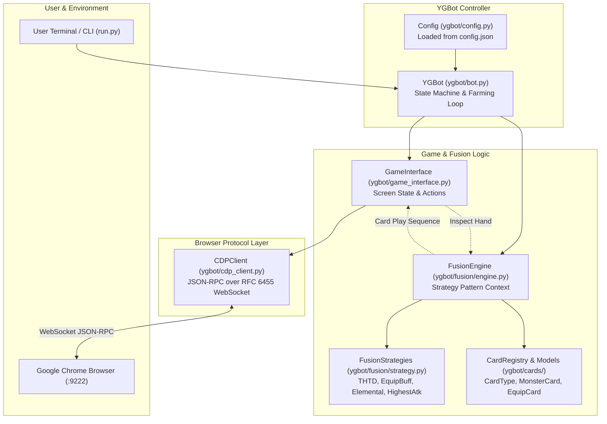
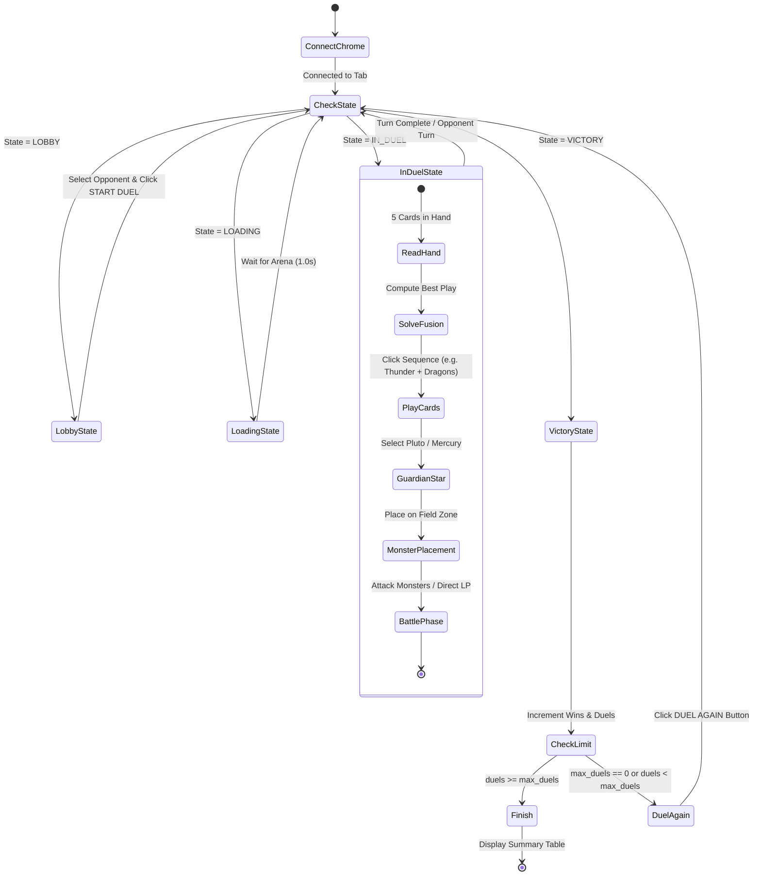

# YGBot - Yu-Gi-Oh! Forbidden Memories Online Auto-Dueler

An autonomous, zero-dependency Python bot that plays **Yu-Gi-Oh! Forbidden Memories Online** directly in Google Chrome.

> 📚 **Architecture & Design Patterns:** See [**CODE_ARCHITECTURE.md**](CODE_ARCHITECTURE.md) for the detailed explanation of the project's code design, class diagrams, sequence flows, and all software design patterns applied.
>
> 🎮 **Game Rules, Mechanics & Card Database:** See [**GAME.md**](GAME.md) for the complete guide to Forbidden Memories mechanics, Guardian Star wheel, fusion recipes, keyboard controls, and card lists.

---

# Section 1: How to Use the Bot

## 1. Prerequisites
- **Python 3.8+** (installed and available in your PATH)
- **Google Chrome** (or Chromium)
- **No external Python libraries required!** The bot is built using Python's standard library and communicates directly with Chrome via the Chrome DevTools Protocol (CDP).

---

## 2. Step-by-Step Usage Guide

### Step 1: Launch Google Chrome with Remote Debugging
The bot connects to Google Chrome using its built-in remote debugging port (`9222`).

You can launch Chrome using the included helper script:
```bash
./launch_chrome.sh
```

Or run Chrome directly from your terminal with a separate profile (so it doesn't conflict if Chrome is already open):
```bash
google-chrome --remote-debugging-port=9222 --user-data-dir="$HOME/.config/ygbot-chrome" "https://ygofm.com/"
```

> **Note:** If Chrome is already running on your computer, Chrome will refuse to open remote debugging without `--user-data-dir` (or until you close all existing Chrome windows). Using `./launch_chrome.sh` handles this automatically.
> Log into your game account in this browser window and navigate to the **Free Duel** screen.

---

### Step 2: Start the Auto-Dueler
In the project directory, run:
```bash
python3 run.py
```

The bot will automatically:
1. Detect your running Chrome window and locate the Forbidden Memories tab.
2. Select your chosen opponent (default: **High Mage Martis**) and click **START DUEL**.
3. Read your hand cards each turn and calculate the highest ATK fusion (e.g., **Twin-Headed Thunder Dragon** at 2800+ ATK).
4. Click the cards in sequence, select the **Guardian Star** (*Pluto*), and place the monster.
5. Enter combat and attack opponent monsters / direct LP.
6. Detect the **VICTORY** screen and click **DUEL AGAIN** to repeat the farming cycle indefinitely.

---

### Step 3: Stopping the Bot & Viewing Stats
Press `Ctrl+C` in your terminal at any time to pause or stop the bot. It will gracefully disconnect and display your session summary:

```text
================================================================
                  FARMING SESSION SUMMARY
================================================================
 Opponent Farmed:     High Mage Martis
 Total Duels:         25
 Victories:           25
 Win Rate:            100.0%
 Total Session Time:  14m 32s
 Avg Time per Duel:   34s
================================================================
```

---

## 3. Command-Line Options

You can override settings on the fly using CLI flags:

| Flag | Short | Description | Default |
| :--- | :--- | :--- | :--- |
| `--url` | `-u` | Target game URL to play | `"https://ygofm.com/"` |
| `--opponent` | `-o` | Name of opponent to farm in Free Duel | `"High Mage Martis"` |
| `--duels` | `-d` | Number of duels to farm (`0` = infinite loop) | `0` (Infinite) |
| `--port` | `-p` | Chrome remote debugging port | `9222` |
| `--star` | `-s` | Preferred Guardian Star | `"Pluto"` |
| `--strategy` | | Fusion strategy: `THTD` or `highest_atk` | `"THTD"` |
| `--test` | | Run diagnostic test to check Chrome connection | `False` |
| `--launch-chrome` | | Automatically spawn Chrome before dueling | `False` |

### CLI Examples

- **Test Chrome connection:**
  ```bash
  python3 run.py --test
  ```

- **Farm 50 duels against High Mage Martis:**
  ```bash
  python3 run.py --duels 50 --opponent "High Mage Martis"
  ```

- **Farm Meadow Mage indefinitely:**
  ```bash
  python3 run.py --opponent "Meadow Mage"
  ```

- **Launch Chrome and start dueling in one command:**
  ```bash
  python3 run.py --launch-chrome --opponent "High Mage Martis"
  ```

---

## 4. Configuration Options (`.env` and `config.json`)

Settings can be customized either via an environment file [`.env`](file:///home/paulo/Projects/YGBot/.env) or JSON config [config.json](file:///home/paulo/Projects/YGBot/config.json).

### Environment File (`.env`)
You can configure the target website and runtime parameters in `.env`:
```env
# Target Game Website
GAME_URL=https://ygofm.com/
TARGET_URL_PATTERN=ygofm.com
ALT_URL_PATTERN=intercityygo.com

# Chrome Remote Debugging Settings
CHROME_HOST=127.0.0.1
CHROME_PORT=9222
CHROME_BINARY=google-chrome
AUTO_LAUNCH=false

# Duel & Farming Settings
OPPONENT=High Mage Martis
MAX_DUELS=0
STRATEGY=THTD
GUARDIAN_STAR=Pluto
ACTION_DELAY=0.5
TURN_WAIT=1.5
COMBAT_WAIT=2.0
LOADING_TIMEOUT=30.0
```

### JSON File (`config.json`)
Persistent options can also be edited directly in [config.json](file:///home/paulo/Projects/YGBot/config.json):

```json
{
  "chrome": {
    "host": "127.0.0.1",
    "debug_port": 9222,
    "game_url": "https://ygofm.com/",
    "target_url_pattern": "ygofm.com"
  },
  "farming": {
    "opponent": "High Mage Martis",
    "max_duels": 0,
    "strategy": "THTD",
    "guardian_star": "Pluto",
    "action_delay": 0.5,
    "turn_wait": 1.5,
    "combat_wait": 2.0
  }
}
```

---

# Section 2: Code Structure & Architecture

> 📖 **Detailed Architecture & Design Patterns:**
> For an in-depth breakdown of the object-oriented design, class interaction diagrams, sequence flows, and all software design patterns applied across the project (Strategy, Domain Model, Factory/Registry, State Machine, Facade, Adapter, and Value Object), see **[CODE_ARCHITECTURE.md](CODE_ARCHITECTURE.md)**.

## 1. Directory Layout

```text
/home/paulo/Projects/YGBot/
├── README.md                  # Quickstart documentation, usage guide & overview
├── CODE_ARCHITECTURE.md       # Comprehensive explanation of code design & design patterns
├── GAME.md                    # Complete game mechanics, Guardian Star wheel & card database
├── .env                       # Environment configuration (target URL, ports, opponent)
├── .env.example               # Template for environment configuration
├── config.json                # User settings (opponent, strategy, speed, coordinates)
├── run.py                     # Command-line entry point
├── launch_chrome.sh           # Helper script to start Chrome with debugging
├── requirements.txt           # Optional dependencies (core bot needs 0 external packages)
├── tests/
│   ├── test_fusion_and_cards.py    # Unit test suite for cards, registry, and fusion strategies
│   └── test_board_interaction.py   # Unit test suite for keyboard navigation and board controller
└── ygbot/
    ├── __init__.py            # Package declaration
    ├── bot.py                 # Core state machine & autonomous farming controller
    ├── board_interaction.py   # Board Controller (Keyboard navigation & Command Pattern)
    ├── cdp_client.py          # Zero-dependency Chrome DevTools Protocol client
    ├── config.py              # Configuration dataclass and JSON loader
    ├── game_interface.py      # In-game screen state detection and action executor
    ├── fusion_engine.py       # Backward-compatibility facade
    ├── utils.py               # Console formatting, ANSI colors, duration and logging helpers
    ├── vision_fallback.py     # Desktop mouse / screen clicker fallback
    ├── cards/                 # Domain package for Cards & Card Types
    │   ├── card_type.py       # CardType Enum (Dragon, Thunder, Equip, Spell)
    │   ├── models.py          # Card, MonsterCard, EquipCard, SpellCard domain models
    │   └── registry.py        # CardRegistry (Factory Method & card database)
    └── fusion/                # Strategy Pattern package for Fusion Logic
        ├── strategy.py        # FusionStrategy ABC & concrete strategies (THTD, Equip, etc.)
        ├── engine.py          # FusionEngine Context class
        └── result.py          # FusionResult Value Object (supports tuple unpacking)
```

---

## 2. Module Responsibilities

### `run.py`
The CLI entry point. Parses command-line arguments, prints the terminal banner, handles the `--test` diagnostic flag, optionally spawns Chrome, and initializes `YGBot`.

### `ygbot/bot.py` (`YGBot`)
The central orchestrator:
- Manages the infinite or fixed-count duel farming loop.
- Executes transitions across game states (`LOBBY` -> `LOADING` -> `IN_DUEL` -> `VICTORY`).
- Tracks duel statistics (victories, duels played, win rate, duration per duel).
- Handles graceful interrupts (`Ctrl+C`) and prints the final session summary.

### `ygbot/cdp_client.py` (`CDPClient` & `SimpleWebSocket`)
The communication layer with Google Chrome:
- Implements a pure Python RFC 6455 WebSocket client using standard `socket`, `struct`, and `base64`.
- Queries the Chrome HTTP debugging endpoint (`/json/list`) to locate the game tab.
- Evaluates JavaScript expressions in the tab context (`Runtime.evaluate`).
- Dispatches accurate mouse press and release events (`Input.dispatchMouseEvent`).
- Supports both DOM-based target clicks and resolution-independent percentage coordinates (`x%`, `y%`).

### `ygbot/cards/` (Domain Model & Factory/Registry Pattern)
Decoupled card representations:
- **`CardType`** (`card_type.py`): Enumeration representing all classic Forbidden Memories archetypes (*Dragon*, *Thunder*, *Equip*, *Spell*, etc.) with domain query properties (`is_monster`, `is_equip`, `is_spell`).
- **`Card`, `MonsterCard`, `EquipCard`, `SpellCard`** (`models.py`): Strongly typed domain classes encapsulating card stats, equip affinities (`can_equip_to()`), and attributes.
- **`CardRegistry`** (`registry.py`): Central database of known FM cards and factory method that normalizes raw input/strings into typed `Card` objects using heuristic token matching.

### `ygbot/fusion/` (Strategy Pattern & Solver Engine)
Modular fusion calculation:
- **`FusionStrategy`** (`strategy.py`): Abstract base strategy defining the hand evaluation interface.
  - **`THTDFusionStrategy`**: Prioritizes the meta **Twin-Headed Thunder Dragon** (2800 ATK) summon (Thunder + Dragon), chaining additional dragons and compatible equip spells.
  - **`EquipBuffStrategy`**: Analyzes monster duplicate bonuses and matches compatible equips (e.g. *Spike Seadra* + *Shine Palace*).
  - **`ElementalFusionStrategy`**: Pairs archetype materials (*Dragon* + *Plant* -> *Black Forest Dragon*, *Beast* + *Pyro* -> *Flame Cerebrus*, *Rock* + *Female* -> *Mystical Sand*).
  - **`HighestAtkStrategy`**: Fallback that summons the single highest ATK monster.
- **`FusionEngine`** (`engine.py`): The Context class coordinating the execution pipeline of fusion strategies.
- **`FusionResult`** (`result.py`): Encapsulates sequence, play name, and estimated ATK with 3-element tuple unpacking compatibility.
- **`ygbot/fusion_engine.py`**: Legacy facade re-exporting all symbols for 100% backward compatibility.

### `ygbot/game_interface.py` (`GameInterface`)
The game action adapter:
- **`detect_screen_state()`**: Inspects page text and DOM elements to determine if the screen is in `LOBBY`, `LOADING`, `IN_DUEL`, `GUARDIAN_STAR`, or `VICTORY`.
- **`start_duel_from_lobby()`**: Clicks the opponent card and clicks the **START DUEL** button.
- **`read_hand_cards()`**: Reads the 5 cards in hand.
- **`choose_guardian_star()`**: Selects *Pluto* or *Mercury*.
- **`perform_attack_sequence()`**: Activates combat and iterates across player monster zones to target opponent zones / direct LP.
- **`click_duel_again()`**: Clicks the cyan **DUEL AGAIN** button upon victory.

### `ygbot/config.py` (`Config`)
Configuration dataclass that loads settings from `config.json` with safe fallback defaults and normalized coordinates for 1920x1080 (scalable to any resolution).

### `ygbot/utils.py`
Helper utilities for terminal color rendering, formatted logging with timestamps, and elapsed time calculation.

---

## 3. Architecture Diagram

The diagram below illustrates how each component communicates:



---

## 4. Autonomous State Machine Flowchart

The following diagram shows the decision cycle executed by `YGBot` on every iteration:


